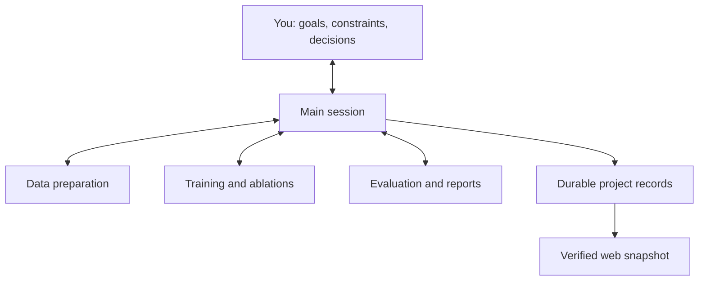

# oh-my-skills

**Useful and playful skills for coding agents, collected from everyday work.**

English · [简体中文](README.zh-CN.md)

This is my growing collection of reusable agent workflows. Each skill lives in its own folder under [`skills/`](skills/), with a `SKILL.md` entry point and the references, templates, or scripts it needs. Install the skills you find useful individually.

The collection starts with workflows for Codex. The instructions use the [Agent Skills](https://agentskills.io) format; execution tools, delegation, and scheduling still depend on the host you use.

## Skills

| Skill | What it does | Good fit |
| --- | --- | --- |
| [Main Session Orchestrator](skills/main-session-orchestrator/SKILL.md) | Coordinates a project through one Main session, bounded execution sessions, artifact-based acceptance, durable handoffs, and a progress dashboard. | Multi-stage research, model-training experiments, and engineering projects. |

## Install

### Ask Codex

Give Codex this request:

```text
Install the main-session-orchestrator skill from
https://github.com/huanngzh/oh-my-skills
at skills/main-session-orchestrator.
```

### Copy the folder yourself

Clone this repository, then copy the entire skill folder into a location your host discovers:

```bash
git clone https://github.com/huanngzh/oh-my-skills.git
cd oh-my-skills

mkdir -p ~/.agents/skills
# Check for an existing installation before copying.
cp -R skills/main-session-orchestrator ~/.agents/skills/
```

For a team repository, use `.agents/skills/` inside that repository instead. Some existing Codex setups use `~/.codex/skills/`; follow your host's supported location and keep only one installed copy of each skill name. Preserve any local customizations before updating. See the [official skill documentation](https://learn.chatgpt.com/docs/build-skills) for discovery locations.

Copy the complete folder, including `references/`, `assets/`, and `scripts/`. Open a new chat and invoke the skill by name after installation.

## Main Session Orchestrator

**Talk mainly to Main; let Main coordinate the stages and collect the evidence.**

Main owns the objective, plan, dispatch, acceptance, and project overview. Execution sessions receive bounded stage briefs and deliver artifacts with enough context for the next stage to continue. Project files retain decisions, owners, inputs, recovery commands, and evidence across sessions.



For a research project, the stages might be data preparation → benchmark freezing → training and ablations → evaluation. Each stage has an owner, fixed inputs, a budget, acceptance gates, and a recovery entry point. Submitted jobs and finished chat turns remain distinct from accepted deliverables.

### Start a project

```text
Use $main-session-orchestrator to manage this project.

Goal: [the outcome and how we will verify it].
Environment: [repository, data, compute, and storage].
Scope and budget: [allowed stages, concurrency, time, and cost limits].

You are my primary point of contact. I authorize you to create and
contact execution chats within this scope and advance after stage
acceptance. Preserve existing owners and paused work. Maintain durable
handoffs and a local progress overview. Bring me decisions that change
the goal or exceed the budget.
```

Adapt the authorization to your actual project. If you want periodic follow-up, explicitly specify its cadence and stopping conditions; Main can configure it only when the host provides an appropriate scheduler.

### Try the local demo

From the repository root, with Python 3.9+:

```bash
# The demo destination must not already exist.
python3 skills/main-session-orchestrator/scripts/demo.py --root /tmp/orchestrator-demo
python3 skills/main-session-orchestrator/scripts/project.py audit --root /tmp/orchestrator-demo
```

Open `/tmp/orchestrator-demo/.orchestrator/web/report.html` in a browser. The demo creates four explicitly fictional stages and an offline page with search and status filters. It uses only the Python standard library and does not launch agents, training, remote connections, or scheduled tasks.

Run the included behavioral checks:

```bash
python3 skills/main-session-orchestrator/scripts/test_project.py
```

### What is included

- Main coordination, executor handoff, and runtime-adapter instructions.
- Templates for the project charter, stage brief, handoff, acceptance, and project rules.
- Local utilities to initialize records, validate their consistency, and build/audit a static overview.
- A fictional demo and tests for evidence integrity, acceptance, dependencies, pauses, and duplicate dispatches.

The skill supplies the workflow and local record tools. Persistent chats, background wakeups, remote compute, and web hosting come from the host and project configuration. The dashboard is a timestamped snapshot, and record validation does not establish that an experiment really ran or that its conclusion is correct.

Read the [quickstart](skills/main-session-orchestrator/references/quickstart.md), [Main loop](skills/main-session-orchestrator/references/main-loop.md), or [state and tools reference](skills/main-session-orchestrator/references/state-and-tools.md) for details.

## Adding more skills

Keep each skill self-contained:

```text
skills/
  skill-name/
    SKILL.md          # Name, description, and entry instructions
    agents/           # Optional host metadata
    references/       # Guidance loaded when needed
    assets/           # Templates used in outputs
    scripts/          # Reusable tools and relevant checks
```

Only add directories the skill needs. Give new skills a clear purpose and invocation example, document runtime requirements, verify any included scripts, and update the catalog in both READMEs. Keep real project state, datasets, checkpoints, credentials, and private session records outside this repository.
