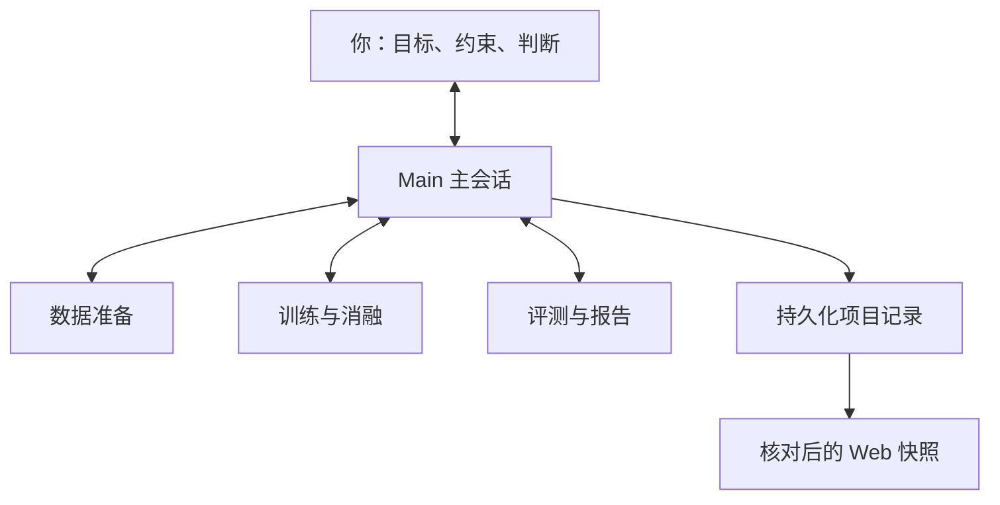

# oh-my-skills

**收集日常工作里好用、好玩的 Agent Skills。**

[English](README.md) · 简体中文

这是我持续维护的个人 Skills 合集。每个 Skill 独立放在 [`skills/`](skills/) 下，以 `SKILL.md` 为入口，按需附带参考文档、模板和脚本。可以只安装你需要的那一个。

当前从 Codex 工作流开始积累，采用 [Agent Skills](https://agentskills.io) 格式。具体的执行工具、会话委派和定时能力取决于使用的宿主环境。仓库中的 Skill 正文为英文，本页提供中文使用说明。

## Skills 目录

| Skill | 能做什么 | 适合场景 |
| --- | --- | --- |
| [Main Session Orchestrator](skills/main-session-orchestrator/SKILL.md) | 以 Main 为统一入口，组织阶段执行会话、依据产物验收、保留交接记录，并维护 Web 总览。 | 多阶段科研、模型训练实验和工程项目。 |

## 安装

### 让 Codex 安装

直接对 Codex 说：

```text
从 https://github.com/huanngzh/oh-my-skills 安装
skills/main-session-orchestrator 目录下的 Skill。
```

### 手动复制目录

克隆仓库后，将完整 Skill 文件夹复制到宿主支持的位置：

```bash
git clone https://github.com/huanngzh/oh-my-skills.git
cd oh-my-skills

mkdir -p ~/.agents/skills
# 复制前先检查是否已有同名安装。
cp -R skills/main-session-orchestrator ~/.agents/skills/
```

团队项目也可以放到项目内的 `.agents/skills/`。部分既有 Codex 环境使用 `~/.codex/skills/`，按宿主实际支持的位置安装，同名 Skill 只保留一份；更新前保留自己的定制内容。发现目录见 [官方文档](https://learn.chatgpt.com/docs/build-skills)。

需要复制整个文件夹，包括 `references/`、`assets/` 和 `scripts/`。安装后新开聊天，通过 Skill 名称调用。

## Main Session Orchestrator

**人主要和 Main 交互，Main 负责串联阶段、执行者与证据。**

Main 维护目标、路线、调度、验收和总览。执行会话接收有边界的阶段任务书，交付产物以及下游继续工作所需的上下文。项目文件保留决策、owner、输入版本、恢复命令和证据，减少对完整聊天历史的依赖。



模型研究中，可以按“数据准备 → benchmark 冻结 → 训练与消融 → 评测”组织工作。每个阶段有 owner、固定输入、预算、验收 gate 和恢复入口；作业提交、聊天结束与阶段验收分别记录。

### 启动项目

```text
使用 $main-session-orchestrator 管理这个项目。

目标：[希望得到什么，以及如何验证]。
环境：[代码仓库、数据、算力和存储]。
范围与预算：[允许的阶段、并发、时间和费用上限]。

你是我的主要交互入口。我授权你在上述范围内创建并联系执行
chats，按阶段验收后继续推进。保留已有 owner 和暂停项，维护
可恢复的交接记录及本地进度总览。涉及目标变化或预算越界时，
再交给我决策。
```

按真实项目调整授权。如果需要持续检查，再明确检查频率和停止条件；只有宿主提供相应 scheduler 时，Main 才能配置后台跟进。

### 体验本地示例

在仓库根目录运行，需要 Python 3.9+：

```bash
# 目标目录必须尚不存在。
python3 skills/main-session-orchestrator/scripts/demo.py --root /tmp/orchestrator-demo
python3 skills/main-session-orchestrator/scripts/project.py audit --root /tmp/orchestrator-demo
```

用浏览器打开 `/tmp/orchestrator-demo/.orchestrator/web/report.html`。示例包含四个明确标为虚构的阶段，以及支持搜索和状态筛选的离线页面。脚本只依赖 Python 标准库，不启动 agent、训练、远程连接或定时任务。

运行随附的行为检查：

```bash
python3 skills/main-session-orchestrator/scripts/test_project.py
```

### Skill 包含什么

- Main 调度循环、执行者交接与宿主适配说明。
- 项目 charter、阶段任务书、交接、验收与项目规则模板。
- 初始化记录、校验一致性、生成和审计静态总览的本地工具。
- 虚构示例，以及覆盖证据完整性、验收、依赖、暂停和重复派发的检查。

Skill 提供流程与本地记录工具。持久会话、后台唤醒、远程算力和 Web 托管由宿主及项目配置提供。总览是带核对时间的快照；记录格式通过校验，不代表实验确实运行或结论一定正确。

详细使用方法见 [Quickstart](skills/main-session-orchestrator/references/quickstart.md)、[Main 工作循环](skills/main-session-orchestrator/references/main-loop.md)和[状态与工具](skills/main-session-orchestrator/references/state-and-tools.md)。

## 后续添加 Skill

每个 Skill 保持独立：

```text
skills/
  skill-name/
    SKILL.md          # 名称、描述和入口指令
    agents/           # 可选的宿主 metadata
    references/       # 按需加载的指导文档
    assets/           # 产物使用的模板
    scripts/          # 可复用工具及相关检查
```

只创建实际需要的目录。新增 Skill 时写清用途、调用示例和运行要求，验证附带脚本，并同步更新中英文 README 中的目录。真实项目状态、数据集、checkpoint、凭据和私人会话记录留在仓库之外。
